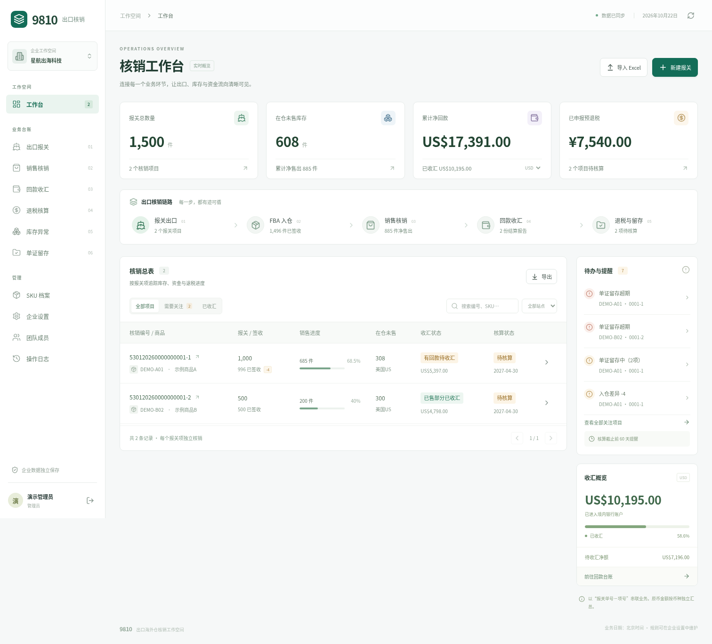

# 9810 · 出口核销工作空间

将《亚马逊9810核销台账模板-初版.xlsx》实现为中文 SaaS 应用。以 **报关单号－项号** 为核销主线，连接出口报关、FBA 入仓、销售、回款收汇、退税核算和单证留存。

**线上应用：** [打开 9810](https://ledger-9810.lively-cake-3869.chatgpt.site)。已发布为私有 Sites 站点，使用创建站点的 ChatGPT 账号登录。

Sites 版源码、测试与发布说明见 [sites/README.md](sites/README.md)，使用 Worker、D1 与 R2 持久化数据。下文的 Python/Docker 版仍可独立部署；两个版本不自动同步数据。



## 已实现

- **核销工作台**：业务链路、在仓库存、分币种收汇统计、核算与单证提醒、搜索、站点过滤和分页。
- **全部模板台账**：SKU 档案、出口报关、销售核销、回款收汇、退税核算、库存异常、单证留存；保留原模板的手填字段和自动字段。
- **自动核算**：人民币折算、预计退税、净销量、库存余额、结算分摊差异、部分收汇、期限与留存状态。
- **FIFO**：按 SKU、结算报告站点及币种筛选库存，按出口日期分配销量；支持预览、金额尾差处理和并发校验。
- **Excel**：原模板导入、校验预览、事务提交、重复跳过、结果导出与再导入。模板示例仅由用户主动载入。
- **多企业与协作**：邮箱密码注册、登录、退出；独立企业空间；指定邮箱的一次性邀请链接；管理员、编辑、只读角色；切换企业与撤销成员会话。
- **单证附件**：按企业授权上传、下载和删除；单文件 10 MB、企业总量 100 MB；与业务数据共同持久化。
- **数据保护**：服务端企业权限校验、不可逆密码哈希、可撤销的 HttpOnly 会话、CSRF 请求头校验、乐观版本锁、操作日志、关联完整性与库存校验。

## 本地启动

需要 Python 3.12+、Node.js 22.12+（推荐 24）。

```bash
git clone https://github.com/andyflag/9810.git
cd 9810
python -m venv .venv
source .venv/bin/activate
pip install -r requirements.txt
npm ci --prefix frontend
npm run build --prefix frontend
python -m uvicorn backend.main:app --host 127.0.0.1 --port 8000
```

打开 **http://127.0.0.1:8000**，点击「创建企业空间」。应用没有默认账号或通用密码。空企业可以点击「体验示例数据」验证原模板流程。

开发前端时另开终端运行 `npm run dev --prefix frontend`，浏览器打开 Vite 提供的地址；`/api` 自动代理到 8000 端口。后端可加 `--reload`。Windows 激活虚拟环境使用 `.venv\Scripts\activate`。

## Docker 部署

```bash
cp .env.example .env
docker compose up -d --build
```

默认在本机 `127.0.0.1:8000` 提供 HTTP 服务，数据保存在 `ledger-data` 卷。Dockerfile 以非 root 用户运行，构建前端后由同一个 API 服务提供页面。

正式公网部署需要域名和 HTTPS 反向代理，把 `.env` 中的 `APP_ENV` 改为 `production` 后重建容器。此时会话 Cookie 使用 `Secure`，必须通过 HTTPS 登录。不要删除数据卷；升级前使用下述 SQLite 备份命令。详细说明见 [部署与运维](docs/DEPLOYMENT.md)。

Python 版可独立部署，Sites 版已上线，入口见上方链接。Docker 配置已提供；自托管版验证采用原生 Python/Node 运行，未实测容器构建。

## 推荐使用顺序

1. 在「企业设置」确认企业类型、企业信息与期限规则。
2. 在「SKU 档案」维护商品、申报单位与退税率。
3. 登记报关单项及 FBA 签收数量；自动生成核销编号。
4. 登记结算报告，再手工登记销售核销或使用 FIFO 分配。
5. 到账后填写**境内银行入账日期和原币金额**；平台到账日期不会被当作收汇。
6. 登记退税申报及核算结果，上传单证并更新留存状态。
7. 在工作台处理库存差异、核算临近、收汇超期和单证问题。

原表及应用中的预退税、收汇和单证期限来自上传模板的规则，不自动跟踪政策变化。实际申报由企业核对，生产企业可在退税记录中填写实际核算截止日。应用不会向海关、税务、亚马逊或银行提交数据。

## 校验

```bash
pip install -r requirements-dev.txt
python -m pytest -q
npm ci --prefix frontend
npm run build --prefix frontend
```

测试覆盖原模板核算、金额舍入、部分收汇、期限边界、跨币种、多个预退税申报的销量分配、Excel 往返及公式注入、事务导入、企业隔离、只读权限、会话撤销、并发冲突、FIFO、附件与重启持久化。浏览器验证记录见 [验收记录](docs/VALIDATION.md)。

## 结构与边界

```text
backend/domain.py       原模板规则、Decimal 金额计算和关联校验
backend/schema.json     从原表提取的完整字段、类型、下拉选项
backend/main.py         登录、企业、台账、附件、Excel、FIFO API
backend/auth.py         密码与会话、角色权限、登录限速
backend/db.py           SQLite 结构、事务、审计
backend/excel.py        Excel 解析、去重与安全导出
frontend/src/           React + TypeScript 中文控制台
backend/sample.json     原模板示例数据（不自动导入）
docs/                   原始工作簿、规则差异、部署与验收说明
tests/                  业务与 API 集成测试
```

这是面向小团队的完整 SaaS 初版：**React 19 + TypeScript + Vite / FastAPI / SQLite WAL**。使用真实服务端持久化，不使用浏览器本地存储保存业务记录。当前采用单实例、单应用进程；不宣称支持多实例分布式部署。未接入付费订阅、邮件发送或自助找回密码；邀请由管理员复制链接分享。需要这些服务时可在现有权限与数据结构上扩展。

详见 [核算规则与模板差异](docs/BUSINESS_RULES.md)。
