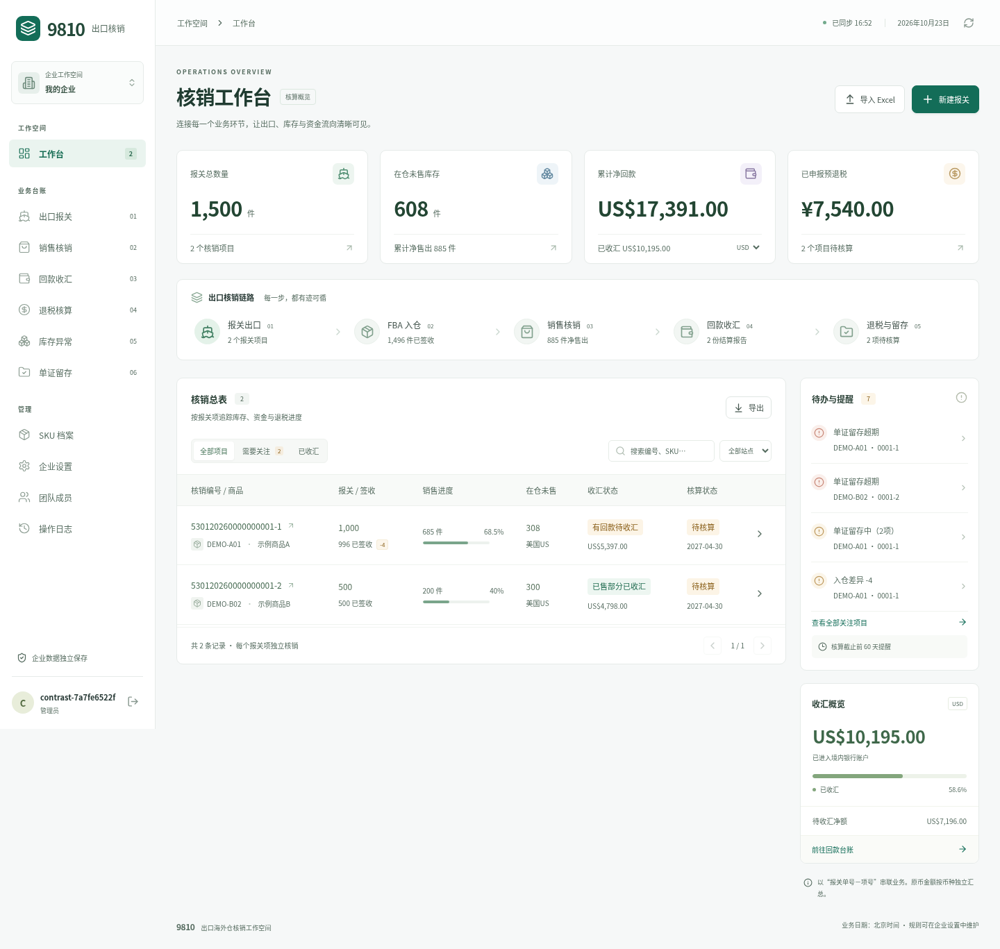

# 9810 全面审查与优化

审查日期：2026-10-22（UTC）。覆盖已发布的 Sites 应用、Python 自部署版本、两版前端、财务规则、Excel 往返、企业隔离、依赖和部署流程。测试全部使用临时或本地示例数据，未向线上企业写入测试台账。

已于 2026-10-22 16:58 UTC 更新[现有私有站点](https://ledger-9810.lively-cake-3869.chatgpt.site)，Sites 返回发布成功。发布源码提交：`76e10754bd650aefadd11de2e0e6b827af33c7e8`，与本仓库 `sites/` 中的跟踪文件逐字节一致。

## 已修复的问题

| 优先级 | 原行为与影响 | 修复结果 |
| --- | --- | --- |
| 高 | 共享登录偏好决定当前企业，双标签切换后旧页面可能把操作发往另一企业 | 每个标签保存自己的企业；请求显式携带企业 ID，下载链接也绑定企业；写请求缺少范围返回 400，已撤销范围返回 403 |
| 高 | Python 请求鉴权后、实际写入前发生撤权，旧请求仍可能写入 | 写事务内再次验证会话和当前角色；管理员操作也复查 owner；Sites 写 SQL 同样验证当前权限 |
| 高 | 极小收汇金额在最后一行承担尾差，四行各 0.01、到账 0.02 可产生一行 -0.01 | 使用整数分与最大余数分摊，合计守恒；FIFO 销售金额、费用共用此方法，覆盖退款负向分录 |
| 高 | 正常申报累计为负时，预退税分配池可能超过实际净销量 | 分配池限制在 0 至实际净销量；负累计明确提醒；正常冲减至零继续合法 |
| 中 | 同日预退税按随机记录 ID 排序，Excel 往返后可能改变分配结果 | 同日按稳定录入顺序；多笔申报共享销量，不重复分配 |
| 中 | 已存在的可选手填列不检查标题，互换列可能静默导错 | 校验所有已有手填列；兼容原模板尚无的可选末尾扩展列 |
| 中 | Excel 超过 15 位有效数字的原始小数丢失精度；Python 尾零不同可重复导入 | 高精度原始数值按文本导出；数值规范化后去重 |
| 中 | XLSX ZIP 目录计数、声明大小和内容不一致可绕过解压预检 | 校验中央目录、本地头、数据描述符、实际解压字节与 CRC；小块流式校验后才交给表格解析器 |
| 中 | JS 保留属性名可被误当成存在的关联记录 | 使用安全索引并校验真实关联，覆盖 `constructor` 等输入 |
| 中 | 仅依赖 Content-Length 的请求限制可被缺失长度绕过 | 两版按实际读取字节执行 12 MB 上限；Excel 文件仍限 10 MB |
| 中 | 并发接受或撤销邀请可能产生错误成功状态 | D1 唯一 claim 与原子批处理；仅一次接受成功，审计与成员写入一致；移除成员同时撤销待用邀请 |
| 中 | 无效 JSON、企业参数类型及 FIFO 字符串布尔值导致 500、重置设置或意外提交 | 返回明确的 422；失败时业务数据和版本不变化 |
| 中 | 企业切换残留旧成员、日志、弹窗；删除最后一页记录后空白 | 取消过期请求、清理企业相关界面、重新校正分页 |
| 中 | 税率 13.5% 被显示成整数；保存中 Escape 可关闭弹窗 | 保留税率及汇率精度；保存中阻止关闭；离开未保存内容前提示 |
| 低 | 新企业先提供不可用的报关入口，辅助文字过浅，移动焦点可离开导航 | 空态先引导建立 SKU；提高文字对比度；移动导航与弹窗限制焦点、支持 Escape 返回触发按钮 |

## 性能与依赖

- 两版计算按结算单、核销编号和报关单建立分组索引，减少每票反复扫描全量数据。
- 添加企业成员、邀请、审计等查询索引；查询计划回归确认使用索引。
- Python 导出在一致性读快照后生成 Excel，不再长时间持有数据库写锁；导出审计不增加业务版本，避免无关的编辑冲突。
- 本地 Node 基准：6,001 条记录、896,165 字节，预热 3 次后取 7 次中位数。最终复测从 **105.80 ms 降至 34.45 ms，减少约 67%**，汇总结果完全相同。单次运行会受机器负载影响，这不是线上 HTTP 延迟或并发压测。
- 基准脚本：`node --import tsx scripts/benchmark.mts`（在 `sites/` 执行）。[优化前测量](review-evidence/perf-before.json)、[优化后测量](review-evidence/perf-after.json)。优化前源码基于 Sites 提交 `59f5c48c5066e1ecd42a94f23d3c6f89e3055363`。
- 升级 Wrangler、drizzle-kit、workers-types，并定点覆盖旧构建链 esbuild。npm 全量依赖由 5 高危、4 中危告警降为 **0 已知漏洞**；原告警涉及开发/构建工具链。运行时和两版前端依赖同样为 0。
- Python 更新 python-multipart、pytest 和 certifi；对最终解析的应用及开发依赖执行 pip-audit，结果为 **0 已知漏洞**。这些结果对应审查时的漏洞数据库，不代表不存在未知问题。

## 验证结果

| 验证 | 结果 |
| --- | --- |
| Python 全套测试，使用升级后的隔离依赖环境 | **44 通过** |
| Python 静态检查 | Ruff 通过，并加入 GitHub CI |
| Sites 规则、Excel、安全及 D1 回归 | **34 通过** |
| 最新 Worker + 本地 D1 / R2 集成 | **6 组通过** |
| 两版前端生产构建、Sites 类型检查和部署打包 | 通过 |
| 自部署版真实 Chromium 注册、示例、新增报关、SKU 增删改、搜索、Excel 下载、移动导航、附件上传、刷新持久化 | 通过，无页面运行错误 |
| Sites 真实 Chromium 企业切换清理、分页和精度、标签范围与下载、保存及未保存保护、设置导航保护、手机键盘焦点与页面宽度、文件选择焦点 | **7 组通过**，无页面运行错误 |
| D1 新迁移应用、现有迁移完整性 | 新迁移通过；已发布的 `0000` 未修改 |

财务回归同时覆盖模板的 13 条原始记录、重复导入、整批失败回滚、极小金额、负数退款、正常申报冲减、同日预退税往返顺序和 8 位小数保存。ZIP 测试覆盖目录计数冲突、伪造大小、CRC 不一致，同时保留合法数据描述符与空 deflate 条目的兼容性。

浏览器采用本机 Chromium，桌面和 390 × 844 手机视口。对 33 个页面、弹层及 hover 状态读取实际样式，检查 2,198 个文本/placeholder 样本（254 组不同样式）；抽查最低对比度 **4.545:1**。装饰图标、禁用控件不计入。这是定点功能与可读性检查，不是完整 WCAG 认证或真机全覆盖。

[功能回归证据](review-evidence/regression-results.json) · [文字对比度统计](review-evidence/contrast-final-statistics.json)

## 更新后的界面

截图均为本次本机测试的示例企业数据。

[手机工作台](review-screenshots/mobile.png) · [手机导入弹窗](review-screenshots/mobile-import.png) · [分页与精度](review-screenshots/pagination-precision.png)

## 升级与验证边界

- 使用现有 Sites 项目和地址，保留 owner 私有访问范围；新增 D1 迁移仅添加邀请 claim 字段和索引，不删除台账。
- 已打开的旧页面需要刷新一次。自建 API 客户端须按 [部署说明](DEPLOYMENT.md) 提供 `X-Workspace-ID`，或在下载 URL 提供 `workspace_id`。
- Sites 身份仍要求平台注入的稳定用户 ID 与邮箱。官方身份契约规定邮箱仅用于展示和联系，服务绕过令牌不提供访客身份。因此没有为截图请求增加邮箱登录回退，也没有伪造线上身份。公开健康检查与部署状态不能替代真实用户的 ChatGPT 登录验收。
- 本轮浏览器认证与业务测试在隔离本地环境完成；未批量修改线上记录，未执行第三方商业系统接入、真实税务申报、Docker 容器验证或公网并发压测。
- Sites 当前每企业 1.5 MB 台账文本、100 MB 附件总量限制保留。此版本未加入计费、自动邮件或 Amazon 自动同步。
- Python 测试剩余一条 Starlette/httpx 测试客户端弃用提示；不影响本次测试，未来升级测试客户端时处理。
